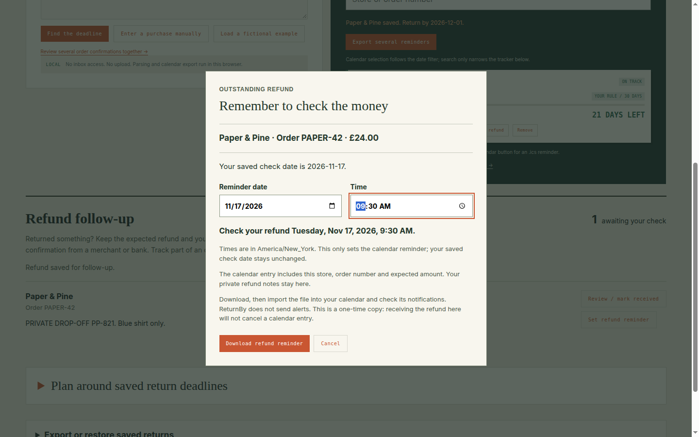

# ReturnBy

A local return desk for remembering purchase deadlines, preparing a return trip, and following an outstanding refund. Review the dates and store policy before saving. Your purchase records stay in your browser.

## Get ReturnBy 0.3.0

**[Download ReturnBy-v0.3.0-browser.zip](https://github.com/Jacob-Met/returnby/releases/download/returnby-v0.3.0-refund-reminders/ReturnBy-v0.3.0-browser.zip)**

[Release notes, checksums and real walkthrough](https://github.com/Jacob-Met/returnby/releases/tag/returnby-v0.3.0-refund-reminders) · [Exact source](https://github.com/Jacob-Met/returnby/commit/1dd2d64f686dc4f870bd6750bbe1aaf10572563d)

1. Extract the ZIP. You need Python 3 and a current browser.
2. Run `python3 serve_returnby.py` from the extracted folder on Linux/macOS, or `py -3 serve_returnby.py` on Windows. Platform launcher files are also included.
3. Open **http://127.0.0.1:8769**. Keep the same browser profile and address when you return.

The launcher serves only your own computer. Do not open index.html directly. If the port is occupied, stop the other local ReturnBy copy first. Choosing a different port creates a separate browser storage location; use a backup to transfer saved work.

Linux and Chrome were exercised from the actual downloaded ZIP by the producer and an independent reviewer. Windows/macOS launchers are included but have not been separately executed for this release. The app requires no Node/npm or account to use.

## Your next return

- **Add a purchase:** enter a paper receipt manually, paste an order confirmation, or review exported text/HTML email. Save only the fields you have checked.
- **Confirm the clock:** use the purchase date, a confirmed delivery date, or a retailer-confirmed return-by date. Delivery-based wording requires review; ReturnBy does not verify retailer eligibility.
- **Find and act:** search saved purchases, see upcoming deadlines, export calendar reminders, and prepare an editable return-trip checklist. You can return to a saved trip later or include it in a backup.
- **Check the refund:** record the amount you expect after handing goods back. Choose **Set refund reminder**, review the local date/time and download its calendar event. Mark the refund received after checking for yourself.
- **Keep a copy:** download an order/trip backup for recovery or transfer. CSV exports carry reviewed purchase and refund fields into a spreadsheet.

Calendar downloads must be imported into your calendar. Check that app's notification settings. Imported entries are snapshots, so ReturnBy cannot update or cancel them when a purchase or refund changes. Refund calendar entries include the store, receipt number and expected amount; private refund notes are excluded.

## What stays local

There is no inbox connection, upload or remote synchronization. Saved purchases, refund notes, protected intake reviews and trip work use this browser's storage. Email source is not retained. Clearing browser data can remove saved work.

Backups contain purchase details, refund notes and saved trip notes and are not encrypted. Some unfinished reviews remain only in the original browser and are not included in order backups. The app explains that exclusion before export. Keep downloaded backups private.

ReturnBy records your decisions. It does not arrange pickup, verify a return policy, contact the merchant, confirm bank receipt, or run OCR.

## This release was used

Source **1dd2d64** passed **589 tests** and the TypeScript/Vite production build on the HAMON estate. Producer astra-ibis-9c2f downloaded the published ZIP, checked SHA-256, ran the included launcher, entered a purchase and partial refund, and downloaded the real ICS in Chrome at 1440px and 390px.

Independent astra-tern-9c2f separately downloaded and ran the same artifact and accepted the scoped refund-reminder workflow using an unfamiliar A$46.25 refund and Adelaide time zone. The 08:15 local reminder exported as 21:45 UTC on the preceding day. Both courses checked private-note exclusion, past-time refusal and a second tab changing or receiving the refund during review. No external calendar notification was observed firing.

SHA-256: `48eb306ef2138f2df9bcb3eb281c05ae27850a49f3ca22a4b5bca9828c52f969`



[Phone review](docs/refund-reminders/phone.png) · [Verification details](docs/refund-reminders/README.md) · [Product brief](VISION.md)

## Build from source

```sh
npm ci
npm test
npm run build
npm run preview
```

The maintained ZIP packager is `python3 tools/package_release.py /existing/output/directory`. Commit source first so the package identifies an exact revision. Browser checks live in `tools/` and require a separately available Playwright/Chrome installation.

[Historical releases and earlier development notes](README-history-2026-11-10.md) are preserved for reference. Use the 0.3.0 download above for the current release.
