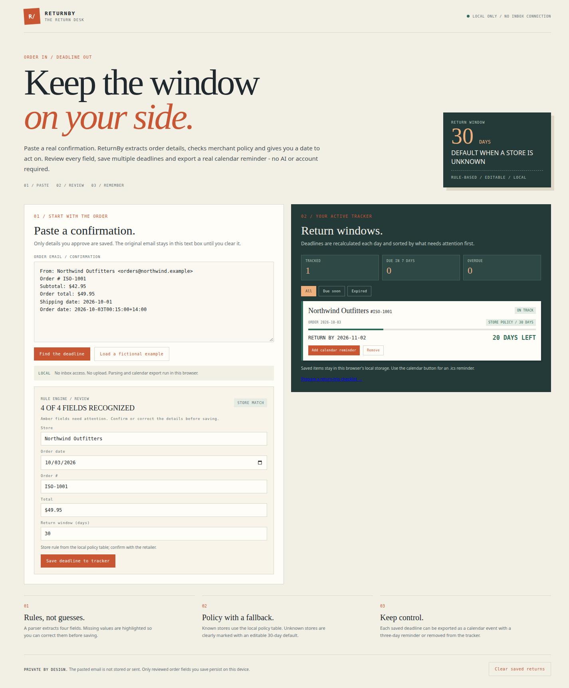
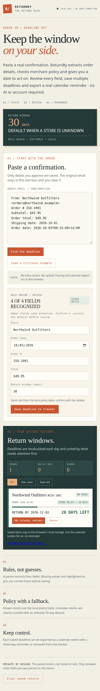

# ReturnBy timestamp dates in the browser

The timestamp repair reaches the actual review form and saved tracker. Fourteen
native-browser journeys passed on 13 October 2026 with Chromium
153.0.8010.47 and Node 22.22.1 on Jacob's ThinkPad.

This is author receiving of candidate
`fa85a0181968c18a5b0d6ff71579a93f73d146b4`, compared with unchanged parser
integration PR54 at `8df144cd393fd66a99f46683c54b55c97665d6e8`.
The candidate parser is the already qualified
`adddc727f469289fa40cb69ab9223f0145747868` blob. No production source or
maintained test changed for this follow-up.

## What the browser received

The frozen fictional confirmation includes a real parser ambiguity:
an October 1 shipping date followed by an explicit
`Order date: 2026-10-03T00:15:00+14:00`.
The original application fills the date input with October 1. A second original
confirmation containing only a negative-offset timestamp produces no order
date. Both original-source witnesses are preserved.

| Course | Observed result |
| --- | --- |
| Two original-source witnesses | Earlier shipping date or missing order date |
| Eight timestamp journeys: two offsets, two viewports, two timezones | Written October 3 date reaches review, storage and reload |
| Two malformed-hour controls | Highlighted missing date; save refused; focus returns to date |
| Two existing plain-date controls | Complete review, save, reload and removal succeeds |

The timestamp journeys use `+14:00` at 00:15 and `-11:00` at 23:45, each
crossing a different UTC calendar boundary. Both retain the date written in the
receipt. Browser timezone emulation was explicitly read back as
Pacific/Kiritimati or America/Los_Angeles.

Native DevTools text insertion and pointer events drive the existing textarea,
Find button, Save button and Remove control. All ten valid candidate journeys
verify the four recognized fields, correct total instead of subtotal, known
merchant policy, exact saved date, stable stored fields after a fresh document
load, visible tracker date and successful removal. The original email stays out
of the saved record. The two malformed controls preserve an empty tracker.

Each navigation is bound to a unique fully loaded document. The receipt records
all 24 served application documents plus their script/style responses. No
external page request or page exception was observed.

## Inspect the actual interface

The two captures were inspected: the recognized form and saved order remain
readable, and neither viewport has page-wide horizontal overflow. The phone
layout stacks the tracker below the review form.





The browser's date input displays its locale's date format; the retained input
value and tracker both bind it to `2026-10-03`. The return deadline displayed
by the unchanged policy/calculation code is also visible in the captures.
These authored confirmations use the fictional local Northwind policy; they
do not establish a real merchant's return policy.

## Use the repaired application

From an exact checkout of the source branch, use the repository's ordinary
commands:

```sh
npm ci --ignore-scripts
npm run dev -- --host 127.0.0.1
```

Open the local address printed by Vite, paste either fictional confirmation
from [the frozen contract](browser-contract.json), and choose Find the deadline.
The reviewed date is October 3. Save it to inspect the retained tracker.

## Exact receiving evidence

| File | Purpose |
| --- | --- |
| [receipt.json](receipt.json) | Complete native-browser checks, observations, requests and cleanup |
| [receive-browser.mjs](receive-browser.mjs) | Exact executed browser receiver |
| [browser-contract.json](browser-contract.json) | Frozen authored receipts and expectations |
| [build-receipt.json](build-receipt.json) | Two strict TypeScript/Vite builds and source/output identities |
| [source-bundle.json](source-bundle.json) | Exact 24-file source projection and candidate parser |
| [build-browser.py](build-browser.py) | Exact executed preparation/build helper |
| [native-processes.json](native-processes.json) | Native process completion and post-run artifact checks |

The unchanged browser receipt is **50,831 bytes**, SHA-256
`f75a3f9350b7687f9b973f8e99c86007e9bcf78b9c2a6e30c8fc287e27287223`.
The build receipt is **17,147 bytes**, SHA-256
`0f3eb7974c147eef08563f5b8bbb57b5188a7854a135ff633fd17b9ce25b32e7`.
The receiver is **16,907 bytes**, SHA-256
`d07accf0cd8c5513059f2c97e10a68371123ced424d13553d5f7667b5e818ff4`.

Native execution used
`/home/jacob/returnby-browser-719c8e1b4e10-9haf7hze`.
The browser course completed in 5.65 seconds with both Chromium and Node exiting
0. The private server closed, the temporary browser profile was removed, and a
later process inspection found no matching owned browser process.
All **48 source placements** and **16 built files** remained unchanged.

Both variants used the unchanged lockfile and the already installed dependency
tree from the earlier task's isolated receiving stage. No package was installed
for this browser follow-up. The exact build helper retains that machine-specific
dependency path as evidence; the ordinary application commands above are the
portable way to use the source.

To repeat the browser course on the still-present native stage, copy the saved
receiver and contract there, select an installed Chromium-compatible browser,
and use a new output directory:

```sh
node receive-browser.mjs --browser /snap/bin/chromium --root /home/jacob/returnby-browser-719c8e1b4e10-9haf7hze --output /home/jacob/returnby-browser-719c8e1b4e10-9haf7hze/new-receiving
```

Keep the published receipt separate from a later run. The receiver refuses an
existing output directory and verifies the supplied source/build identities.

## Scope and ownership

The source branch continues to preserve PR54's subtotal and explicit-date
selection contributions. This follow-up adds actual browser consumer evidence
to the earlier 120-test/Vitest qualification. It does not provide independent
source review, physical calendar downloads, a physical-phone or screen-reader
result, broad deadline-arithmetic qualification, or a deployed-site result.
Chrome's native stderr is retained; an empty browser-background log is not
claimed.

The existing parser-integration owner retains stack adoption. Source publication
adds receiving evidence only on the timestamp repair's own branch. Owner
branches, main, workflow definitions and installed services remain unchanged.
